<p align="center">
  
</p>

<p align="center">
  <a href="PASTE_YOUR_VIDEO_LINK_HERE"><b>🎬 &nbsp;WATCH THE VIDEO</b></a>
  &nbsp;&nbsp;·&nbsp;&nbsp;
  <a href="MallShopperSegmentation_UnsupervisedLearning.ipynb"><b>📓 &nbsp;OPEN NOTEBOOK</b></a>
  &nbsp;&nbsp;·&nbsp;&nbsp;
  <a href="summary_report.md"><b>📝 &nbsp;READ SUMMARY</b></a>
</p>

<p align="center">
  
  
  
  
</p>

---

## 🧾 ORDER SUMMARY

```text
 ┌────────────────────────────────────────────────────┐
 │             MALL SHOPPER SEGMENTATION              │
 │               Unsupervised Learning                │
 ├────────────────────────────────────────────────────┤
 │ Customers .................................... 200 │
 │ Features .............. Gender, Age, Income, Score │
 │ Algorithms ................. K-Means, Ward, DBSCAN │
 │ Best model ......................... K-Means (k=5) │
 │ Personas found ................................. 5 │
 │ K-Means vs Ward agreement .................... 98% │
 │ K-Means across seeds ............. 0.5547 ± 0.0000 │
 ├────────────────────────────────────────────────────┤
 │               THANK YOU · COME AGAIN               │
 └────────────────────────────────────────────────────┘
```

Clustering **200 mall customers** with **K-Means, Agglomerative (Hierarchical) clustering and DBSCAN** to discover shopper personas and turn them into **retail strategies** for a Phoenix Marketcity / Nexus Malls-style mall chain.

**Dataset:** [Mall Customer Segmentation Data (Kaggle)](https://www.kaggle.com/datasets/vjchoudhary7/customer-segmentation-tutorial-in-python) · 200 rows · `Gender`, `Age`, `Annual Income (k$)`, `Spending Score (1–100)`

---

## 🏷️ RESULTS AT A GLANCE

| Algorithm | Clusters | Silhouette ↑ | Davies-Bouldin ↓ | Calinski-Harabasz ↑ | Noise |
|---|:-:|:-:|:-:|:-:|:-:|
| ✅ **K-Means (k=5)** · *recommended* | 5 | 0.555 | 0.572 | 248.6 | 0% |
| **Agglomerative** (Ward, 5) | 5 | 0.554 | 0.578 | 244.4 | 0% |
| **DBSCAN** (eps 0.4, min_samples 10) | 4 | 0.597\* | 0.473\* | 263.6\* | 25.5% |

> [!NOTE]
> \*DBSCAN is scored on **non-noise points only** and loses the **Budget Shopper** segment. K-Means and Ward agree on **98%** of customers, and K-Means is stable across seeds (0.5547 ± 0.0000).

---

## 🪪 SHOPPER PERSONA CARDS

<table>
<tr>
<td width="33%" valign="top">

### 💎 Big Spenders
**19.5%** of shoppers

**Profile:** High income, high spend, age ~33

**🎯 Strategy:** Premium lounge and luxury pop-ups near the food court

</td>
<td width="33%" valign="top">

### 🧐 Careful Spenders
**17.5%** of shoppers

**Profile:** High income, low spend, age ~41

**🎯 Strategy:** Experiential events, personal shoppers, quality-led offers

</td>
<td width="33%" valign="top">

### ⚡ Young Aspirers
**11%** of shoppers

**Profile:** Low income, high spend, age ~25

**🎯 Strategy:** Trend zone, student/EMI deals, flash sales

</td>
</tr>
<tr>
<td width="33%" valign="top">

### 🛒 Mainstream Shoppers
**40.5%** of shoppers

**Profile:** Mid income, mid spend, age ~43

**🎯 Strategy:** Central atrium brands, points-based loyalty

</td>
<td width="33%" valign="top">

### 🏷️ Budget Shoppers
**11.5%** of shoppers

**Profile:** Low income, low spend, age ~45

**🎯 Strategy:** Value stores near entrances, ₹50-off app coupons

</td>
<td width="33%" valign="top" align="center">

### 📊 Total
**5 personas**

**200 shoppers**

**100%** of the mall's customers

</td>
</tr>
</table>

**Share of shoppers**

```text
  Mainstream Shoppers   ████████████████████  40.5%
  Big Spenders          ██████████            19.5%
  Careful Spenders      █████████             17.5%
  Budget Shoppers       ██████                11.5%
  Young Aspirers        █████                 11.0%
```

---

## 🖼️ SCREENSHOTS

<table>
<tr>
<td width="33%" align="center"><br><sub><b>Elbow + Silhouette</b></sub></td>
<td width="33%" align="center"><br><sub><b>K-Means clusters</b></sub></td>
<td width="33%" align="center"><br><sub><b>Dendrogram</b></sub></td>
</tr>
<tr>
<td width="33%" align="center"><br><sub><b>k-NN distance (DBSCAN)</b></sub></td>
<td width="33%" align="center"><br><sub><b>DBSCAN grid</b></sub></td>
<td width="33%" align="center"><br><sub><b>DBSCAN clusters</b></sub></td>
</tr>
</table>

---

## ▶️ HOW TO RUN

```bash
git clone https://github.com/<your-username>/mall-shopper-segmentation-unsupervised-learning.git
cd mall-shopper-segmentation-unsupervised-learning
pip install -r requirements.txt
jupyter notebook MallShopperSegmentation_UnsupervisedLearning.ipynb   # Run All
```

**Classify a new shopper** from the saved pipeline:

```bash
python classify_shopper.py 22 30 85 Female    # age, income (k$), spending score, gender
```

---

## 🗂️ FILES

| File | Description |
|---|---|
| `MallShopperSegmentation_UnsupervisedLearning.ipynb` | Fully executed notebook (EDA → clustering → business interpretation) |
| `mall_scaler.pkl` | Saved `StandardScaler` (Income, SpendingScore) |
| `mall_segmentation_model.pkl` | Saved best model (K-Means, k=5) |
| `summary_report.md` | ~1-page summary |
| `classify_shopper.py` | Script version of `classify_shopper()` |
| `Mall_Customers.csv` | Dataset |
| `requirements.txt` | Dependencies |
| `images/` | Saved plots |
| `assets/receipt_header.svg` | README header image |

---

<p align="center">
  <b>✍️ Mayur Makwana</b><br>
  <sub>Mall Shopper Segmentation · Unsupervised Learning</sub>
</p>
